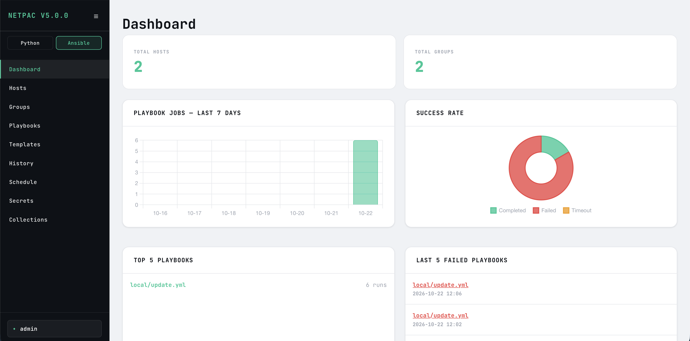
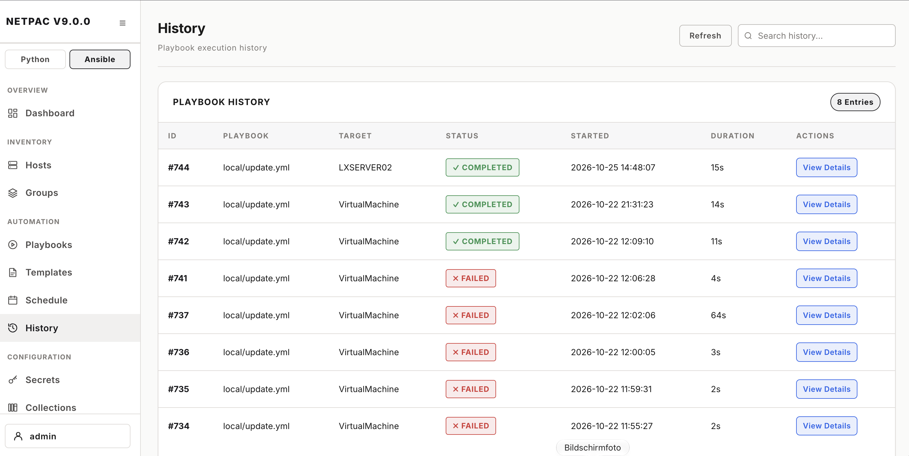

# NetPAC - Network Python & Ansible Center

<p align="center">
  <a href="#netpac-configuration"></a>
  <a href="https://github.com/JimPeterle/NetPAC/releases/latest"></a>
  <a href="LICENSE"></a>
  <br>
  
  
  
  <a href="#installation-with-docker"></a>
</p>

> [!NOTE]
> NetPAC is made for **Linux servers (Ubuntu / Debian)**, installed with `setup.sh` or with Docker.
> Windows and macOS are not supported as a host.

NetPAC is a network automation and management platform. You can create an inventory of 
hosts and groups and use this inventory for Python scripts and Ansible 
Playbooks.

<p align="center">
  
</p>

For login, you can use RADIUS or a local user. All users are required to 
set up two-factor authentication (TOTP) on first login.

For local login you can use for first startup the user **admin** with password **admin**, after login and totp verification please change the default password under Settings -> Change Password of local user. 
Admins can add more local users and assign roles under Settings -> User (see [Users and roles](#users-and-roles)). 

For RADIUS login, the local admin configures the RADIUS server under 
Settings -> Radius. The shared secret is stored encrypted in the database.

setup.sh creates a self-signed SSL certificate. Your own certificate 
can be uploaded later under Settings -> SSL/TLS.

## Python

All scripts located under **/var/lib/netpac/scripts** are displayed in the 
GUI and can be executed there. Scripts can also be synced directly from 
a Git repository via the built-in Git Sync feature in the UI.


Python support:
- Running a playbook against a target host, host group, or locally 
  (no target required)
- Passing extra vars at runtime
- Schedule script jobs

A Python virtual environment (venv) is available for scripts and can be 
managed directly in the GUI (install, update, remove packages).

## Ansible Playbooks

All playbooks located under **/var/lib/netpac/playbooks** are displayed 
in the GUI and can be executed there. Playbooks can also be synced 
directly from a Git repository — Scripts and Playbooks share the same 
Git sync target, so both are updated with a single sync.

Playbooks support:
- Running a playbook against a target host, host group, or locally 
  (no target required)
- Passing extra vars (survey variables) at runtime
- Syntax checking before execution
- Visual graph generation via ansible-playbook-grapher
- Playbook dry run mode
- Reusable **Playbook Templates**, which save a playbook path together 
  with a target, extra vars, and secrets for quick, repeatable launches

Ansible Collections (via ansible-galaxy) can be installed, updated, and 
removed directly in the GUI. Collections that are part of the system's 
base installation are shown separately as read-only and are not managed 
through NetPAC.

## Credentials & Scheduling

Credentials can be stored encrypted in the Secrets section and are 
injected into scripts and playbooks at runtime as environment variables.

Scripts can be scheduled with cron expressions (hourly, daily, weekly, 
or custom) via the Scheduler. Each schedule supports targets, variables, 
and secrets.

## Job queue

Jobs are started by a separate service, **netpac-executor**. Every job is first
placed in a queue (status **queued**) and started as soon as a slot is free. By
default up to 5 jobs run in parallel; this can be changed with
`MAX_PARALLEL_JOBS` in netpac.py.

A host is only used by one job at a time, no matter which script or playbook.
The check uses the actual hosts behind the target: an update playbook can run
against the group *routers* and the group *switches* in parallel, but if both
targets contain the same host, or another playbook is already running on one of
those hosts, the job waits until the host is free. Jobs without hosts (no target
or localhost) only wait for a running job of the same script or playbook. Queued jobs can be removed from the queue on the job detail page.
A schedule is skipped if its previous run is still waiting in the queue.

Jobs running longer than 4 hours are stopped and get the status **timeout**.
Up to 10 MB of output is stored per job; for larger output the beginning and
the end are kept.

## Hosts

Hosts can be created, edited, and deleted in the GUI and assigned to 
multiple groups.

## Users and roles

Every user has one of three roles:

| Role | Permissions |
|---|---|
| **Admin** | Everything, including Settings (users and roles, RADIUS, notifications, Git repository, SSL, backups, logs, audit log) and Health |
| **Operator** | Everything except Settings and Health: run scripts and playbooks, manage hosts, groups, templates, schedules, secrets, Python packages and Ansible collections |
| **Viewer** | View only: hosts, scripts, playbooks, templates, schedules, job history and the list of secrets — no changes |

- Roles are assigned by an admin under Settings -> User and take effect immediately.
- The local user `admin` always has the Admin role and can't be deleted; further users can be admins as well.
- RADIUS users are created as Viewer on their first login; an admin assigns their role in NetPAC.
- Every user can change their own password (local users only — RADIUS passwords are managed by the RADIUS server).
- Actions that are not allowed are hidden; if called anyway, NetPAC shows a message instead of performing them.
- All operators see and manage all schedules. A schedule runs in the name of its owner; if the owner is deleted
  or downgraded to Viewer, their schedules are paused. An operator who activates such a schedule again becomes its owner.
- Denied actions are recorded in the audit log (`access.denied`).

> [!IMPORTANT]
> Give the Operator role only to people you trust with the server itself. Operators run scripts and playbooks,
> set Ansible variables and install Python packages and Ansible collections — all of this executes code on the
> NetPAC server as the NetPAC user, which can read `config/secret.env`. The roles protect against mistakes and
> limit Viewers; they are not a barrier against a malicious Operator.
- When roles are introduced by an update, existing users become Operator and `admin` becomes Admin.

## Monitoring & Logs

<p align="center">
  
</p>

The output of scripts and playbooks can be viewed in the job history and 
exported as TXT. Running jobs can be cancelled from the job detail page; 
they are then shown with the status **cancelled**. Jobs whose process 
disappeared (e.g. after a NetPAC restart) are marked as **failed**. System logs can be viewed directly in the Settings area. 
A Health page shows the status of the database, scheduler, job executor, 
encryption, venv, and Ansible Galaxy collections at a glance.

Jobs are kept in the history for 180 days; older finished jobs are deleted
automatically once a day by the scheduler. The log files in /var/log/netpac are
rotated weekly and kept for 8 weeks (logrotate, set up by setup.sh).

The UI supports a dark and light mode.

The following explains the steps required to install NetPAC:

1. [Prepare the server](#prepare-the-server) — create the user `netpac` (both ways)
2. [Database configuration](#database-configuration) — install MariaDB and create the database (both ways)
3. Install NetPAC either with [setup.sh](#netpac-configuration) or with [Docker](#installation-with-docker)

## Prepare the server

NetPAC runs as its own user `netpac`, with `setup.sh` as well as with Docker.
Create the user as root:
```Bash
sudo -i
adduser netpac
```

The user needs sudo rights: `setup.sh` creates the system services with them,
and the `netpac` command uses them to restart the services.
```Bash
usermod -aG sudo netpac
```

## Database configuration

Passwords in user table are stored as bcrypt hashes.
In my setup, I use a mariadb, but a mysql database can also be used.

Here is a prepared configuration to install and create the database.

Install mariadb:

```bash
sudo apt update
sudo apt install mariadb-server -y
```

Start mariadb and add to autostart:

```bash
sudo systemctl start mariadb
sudo systemctl enable mariadb
sudo systemctl status mariadb
```

If you'd like, you can secure a new MariaDB/MySQL installation by following the steps after running the command. This is entirely optional and, among other things, removes anonymous users and the test database:

```bash
sudo mariadb-secure-installation
```

Login as root:

```bash
sudo mariadb -u root -p
```

Start the netpac_db installation. But first, fill in the fields marked with # at the beginning in three places; you'll need to remove the # symbols to do so.:

```sql
CREATE DATABASE IF NOT EXISTS `netpac_db` 
DEFAULT CHARACTER SET utf8mb4 
COLLATE utf8mb4_bin;

CREATE USER '#YOUR-USER#'@'localhost' IDENTIFIED BY '#YOUR-PASSWORD#';

GRANT ALL PRIVILEGES ON netpac_db.* TO '#YOUR-USER#'@'localhost';

FLUSH PRIVILEGES;
```

The tables are created automatically when NetPAC starts for the first time.
Later database changes are applied the same way on every start (database migrations,
see `database/migrations`). Before changing an existing database, NetPAC creates a backup
in the `netpac_backups` folder. The current state can be checked with:

```Bash
netpac db
```

With Docker, the migrations are part of the image. Check the state with:

```Bash
docker compose exec web python3 app/db_migrations.py
```

## NetPAC configuration

Installation with `setup.sh`. The user `netpac` must exist (see [Prepare the server](#prepare-the-server)).

Switch to the user `netpac`, install git and clone NetPAC:
```Bash
su - netpac
sudo apt install git
mkdir bin
cd bin/
git clone https://github.com/JimPeterle/NetPAC.git
cd NetPAC
```

The user `netpac` and the directory `~/bin/NetPAC` are the recommended layout, 
but not required: all services run as the user that executes `setup.sh`, from 
the folder NetPAC was cloned to. Database backups are stored next to the 
application directory (e.g. `~/bin/netpac_backups`).

The repository is organised in these folders:

| Folder | Content |
|---|---|
| `app/` | NetPAC itself (web interface, scheduler, executor, database migrations, templates, static files) |
| `config/` | Configuration: `secret.env` (created by you), the template `secret_examples.env`, the RADIUS dictionary |
| `maintenance/` | `setup.sh`, `update_netpac.sh`, `uninstall.sh`, `update_vendor.py` and the `netpac` command |
| `database/migrations/` | Database changes, applied automatically on start |
| `docker/` | Docker image and docker-compose.yml |

Create your configuration from the template and fill in the values. 
secret.env is excluded from Git, so later updates via `git pull` never 
overwrite it.

```Bash
cp config/secret_examples.env config/secret.env
vim config/secret.env
```

Generate the ENCRYPTION_KEY (encrypts the stored secrets, tokens and TOTP secrets in the database):
```Bash
sudo apt install python3-cryptography
python3 -c "from cryptography.fernet import Fernet; print(Fernet.generate_key().decode())"
```

Keep a backup of config/secret.env. Without the ENCRYPTION_KEY, the stored secrets 
can no longer be decrypted (Store the keys inside a Keepass).

### Lost or changed ENCRYPTION_KEY

The TOTP secrets of all users are encrypted with the ENCRYPTION_KEY as well. If the key is lost
or changed, **nobody can log in anymore** (including `admin`): the login shows
"Your two-factor secret can't be read on the server" and `netpac.log` contains a CRITICAL entry
"Cannot decrypt TOTP secret".

To regain access, reset the TOTP of the affected user in the database. On the next login,
a new QR code is shown and TOTP is set up again:
```sql
UPDATE user SET totp_secret = NULL, totp_confirmed = FALSE, totp_last_counter = NULL WHERE name = 'admin';
```

Everything else encrypted with the old key is lost as well and has to be entered again:
the passwords of all Secrets, the Git access token, the RADIUS shared secret and the
SMTP password / Matrix token of the notifications.

When everything is ready, the final step can be carried out.
```Bash
bash maintenance/setup.sh
```

setup.sh also installs the `netpac` command (see [The netpac command](#the-netpac-command)).

## Installation with Docker

Instead of `setup.sh`, NetPAC can run in Docker. The image contains NetPAC with
Python, Ansible and all dependencies on its own Ubuntu base, so the host can run
any Linux distribution with Docker (e.g. Ubuntu 24.04). The database stays on the
host: install MariaDB and create an empty database and user as described in
[Database configuration](#database-configuration). No schema has to be imported —
NetPAC creates all tables on the first start, the migrations are included in the image.
All Docker files are in the `docker/` folder of the repository.

Requirements on the host:
- Docker Engine with the Compose plugin, Compose 2.23 or newer (`docker compose version`).
  Docker's official repository is recommended (docs.docker.com, "Install Docker Engine on Ubuntu").
- MariaDB 10.11 or newer (tested with 11.8). Ubuntu 24.04 ships 10.11; newer versions are
  available from the official MariaDB repository.
- Free ports 80 and 443.

Web interface, scheduler and executor run as three containers from the same image,
plus nginx as reverse proxy. All containers use the host network, so `DB_IP=127.0.0.1`
works as with a normal installation.

The user `netpac` must exist (see [Prepare the server](#prepare-the-server)). After installing Docker,
allow it to use Docker, then log in again as `netpac` so the new group takes effect:
```Bash
sudo usermod -aG docker netpac
su - netpac
docker ps
```
`docker ps` must work without `sudo`. Members of the `docker` group have root-equivalent rights
on the host, so only add the NetPAC user.

All following steps are done as user `netpac`. Download the two files and fill in secret.env (see [NetPAC configuration](#netpac-configuration)
for the values and how to create the ENCRYPTION_KEY):
```Bash
mkdir netpac && cd netpac
curl -O https://raw.githubusercontent.com/JimPeterle/NetPAC/main/docker/docker-compose.yml
curl -o secret.env https://raw.githubusercontent.com/JimPeterle/NetPAC/main/config/secret_examples.env
chmod 600 secret.env
vim secret.env
```

Start NetPAC:
```Bash
docker compose up -d
```

On the first start a self-signed certificate is created in `/etc/netpac/certs`.
A certificate uploaded later in the GUI is used after `docker compose restart nginx`.

### Data and folders

The containers use the same paths as a normal installation. They are stored on the host:

| Host | Content |
|---|---|
| `/var/lib/netpac` | Scripts, Playbooks, Git sync, graphs |
| `/var/log/netpac` | Log files |
| `/etc/netpac/certs` | TLS certificate |
| `./backups` | Database backups (next to docker-compose.yml) |

Python venv, Ansible collections, SSH known_hosts and the Git sync settings are kept
in Docker volumes, so they survive updates.

The containers run as UID/GID 1000. Check the IDs of the user `netpac` with `id -u` and `id -g`;
if they differ, change `PUID` and `PGID` in docker-compose.yml. Folders that do not exist
yet are created with this owner; existing folders must be writable by it.

The log files are not rotated inside the containers. Use logrotate on the host,
e.g. `/etc/logrotate.d/netpac`:
```
/var/log/netpac/*.log {
    weekly
    rotate 8
    compress
    delaycompress
    missingok
    notifempty
    copytruncate
    su netpac netpac
}
```

### Update and commands

```Bash
docker compose pull && docker compose up -d   # update (database changes are applied automatically)
docker compose ps                             # status
docker compose logs -f executor               # container output
docker compose restart                        # restart everything
```

Playbooks with "Run on the NetPAC server (localhost)" run inside the executor container,
not on the host.

## Frontend libraries

NetPAC loads nothing from the internet: all frontend libraries (anime.js, 
highlight.js, Chart.js, flatpickr, github-markdown-css) and the JetBrains Mono 
font are stored in `app/static/vendor/`. This also works in management networks 
without internet access and transfers no user data to third parties.

The versions are defined in `app/static/vendor/manifest.json`. Update them on your
development machine and commit the result — servers get them with the next update:

Show available updates (changes nothing):
```Bash
python3 maintenance/update_vendor.py
```

Update all libraries to their latest release. The new version is downloaded,
`app/static/vendor/manifest.json` is updated and the old version is removed.
If a download fails, the library stays on its current version.
```Bash
python3 maintenance/update_vendor.py --update
```

New major versions (e.g. 4.x -> 5.x) are skipped, as they may break NetPAC.
Check the changelog first, then install them explicitly, optionally only for
single libraries:
```Bash
python3 maintenance/update_vendor.py --update --major chartjs
```

Restart NetPAC afterwards (`netpac restart`), because the
manifest is read at startup.

Each library keeps its license file in its own folder under `app/static/vendor/`.

## Additional information

For all users who need to create scripts:
``` Bash
sudo usermod -aG netpacscript <user>
```

## The netpac command

setup.sh installs the command `netpac` (`/usr/local/bin/netpac`). Run it as the NetPAC user:

| Command | |
|---|---|
| `netpac status` | State of the NetPAC services |
| `netpac start` / `stop` / `restart` | Start, stop or restart all NetPAC services |
| `netpac update` | Update NetPAC (git pull, database changes, restart) |
| `netpac logs [name]` | Follow a log file: `netpac` (default), `execution`, `scheduler`, `gunicorn_error`, `gunicorn_access` |
| `netpac db` | Database migration state (`--apply` applies pending changes now) |
| `netpac version` | NetPAC version and Git commit |
| `netpac uninstall` | Remove NetPAC from the server (asks before every step) |
| `netpac help` | All commands |

With Docker, use `docker compose` instead (see [Installation with Docker](#installation-with-docker)).

## Remove Netpac

If you want to remove netpac do these steps as netpac user:
``` Bash
netpac uninstall
```

Then as root:
``` Bash
sudo pkill -u netpac
sudo deluser netpac sudo
sudo deluser --remove-home netpac
```
After this steps netpac is removed from your system.

## License

NetPAC is released under the MIT License: use, copy, modify and distribute it for any
purpose, as long as the license text is included. See [LICENSE](LICENSE).

The third-party libraries and fonts in `app/static/vendor` keep their own licenses
(their license files are included in each folder).